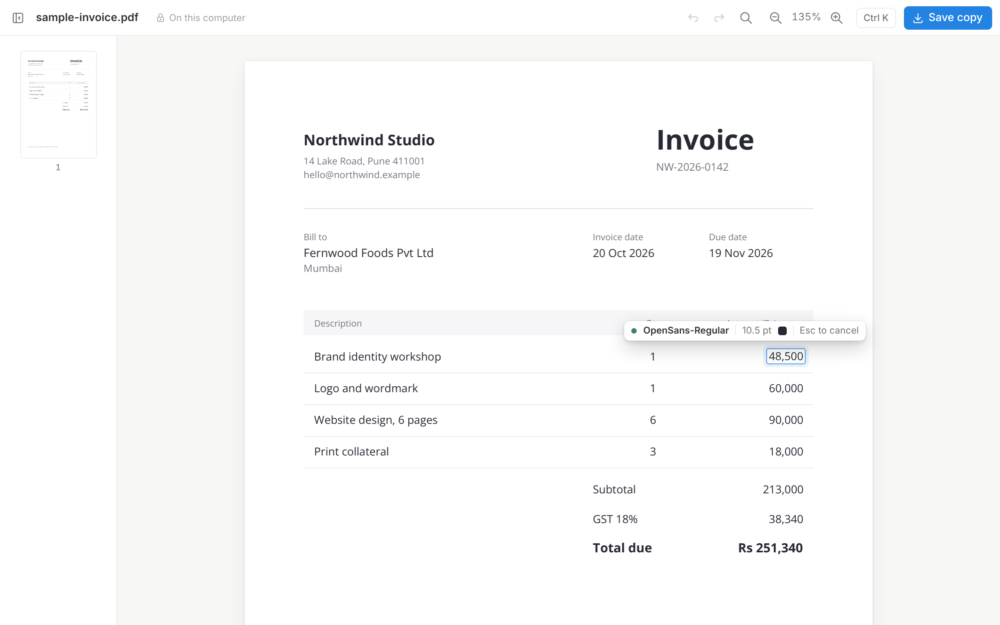

# Inkwell PDF

**Edit the text in any PDF, in its own font, on your own computer.**

Click a word, type, and click away. Inkwell PDF rewrites the text in the PDF itself, using the same font, size and colour as the original. Nothing is uploaded. There's no account and no tracking.



## Download

Get the installer for your computer from **[Releases](../../releases)**. No Python or anything else is needed.

**Mac:** download `InkwellPDF-…-macOS-arm64.dmg` for Apple silicon (M1 and later) or `…-x86_64.dmg` for Intel. Open it and drag Inkwell PDF into Applications. The app isn't signed by Apple yet, so the first time you open it macOS will block it:

1. Try to open Inkwell PDF once, then close the warning.
2. Open **System Settings → Privacy & Security**, scroll down, and click **Open Anyway** next to Inkwell PDF.

**Windows:** download `InkwellPDF-…-Windows-Setup.exe` and run it. It installs for your user account, so you don't need administrator rights, and adds Inkwell PDF to the Start menu and to "Open with" for PDFs. Windows SmartScreen may warn about an unrecognised app: click **More info → Run anyway**.

## How to use it

| To | Do this |
|---|---|
| Open a PDF | Drop it on the window, or press ⌘O |
| Edit text | Click it and type. Click anywhere else to keep the change |
| Cancel an edit in progress | Esc |
| Move to the next line | Tab |
| Find and replace | ⌘F |
| Undo / redo | ⌘Z / ⇧⌘Z |
| Save | ⌘S saves `<name> (edited).pdf` next to your file, and later saves update it. Your original is never changed |
| Save somewhere else | ⇧⌘S |
| Everything else | ⌘K |

While you type, a small label shows which font the new text will use:

- **Green:** the PDF's own font. It looks exactly like the original.
- **Orange:** a few characters aren't in that font, so a similar font draws just those characters.
- **Red:** no font on your computer can draw a character, so the change can't be made.

## How "same font" works

PDFs usually carry only the letters they use. Type a letter the file doesn't have, and most editors swap the whole line to Helvetica. Inkwell PDF picks a font per character instead, in this order:

1. The font embedded in the PDF.
2. The full version of that font, from the app's `fonts` folder, `~/Inkwell PDF Fonts`, or the fonts installed on your Mac.
3. A similar font, only for characters neither of the above has.

Old text is actually removed from the file, not covered with a white box. Backgrounds, table lines and images stay untouched.

## Limits

- **Scanned PDFs:** these are pictures of text, so there's nothing to edit.
- **Rotated text:** not supported yet.
- **Longer text:** a longer replacement doesn't push the rest of a paragraph along. You'll see a warning if it runs into nearby text.
- **Unlabelled symbols:** some PDFs draw symbols, like `₹` in Chrome-printed files, without saying which character they are. Lines containing them are locked so they can't be damaged.
- **Platforms:** installers for macOS and Windows. Linux runs from source.

## Run from source

```bash
git clone https://github.com/<you>/inkwell-pdf && cd inkwell-pdf
python3 -m venv .venv && source .venv/bin/activate
pip install -r requirements.txt
python -m inkwellpdf            # the desktop app
python -m inkwellpdf some.pdf   # open a file straight away
```

## Develop

```bash
pip install -e ".[dev]"
pytest                          # engine tests
python -m inkwellpdf.dev_server   # the same interface in a browser at http://127.0.0.1:8765
./scripts/build_macos.sh        # on a Mac: dist/Inkwell PDF.app and a .dmg
./scripts/build_windows.ps1     # on Windows (needs Inno Setup 6): dist/InkwellPDF-…-Windows-Setup.exe
```

Pushing a tag such as `v0.1.0` builds the Mac (Apple silicon and Intel) and Windows installers on GitHub Actions and attaches them to a release. To test the builds without releasing, open **Actions → Release → Run workflow**; the installers appear as downloadable artifacts.

Both build scripts finish by running the packaged app with `--self-test`, which opens, edits and saves a PDF, so a broken package fails the build.

| File | What it does |
|---|---|
| `inkwellpdf/engine.py` | Reads text runs, chooses fonts, removes and rewrites text, saves. No UI code |
| `inkwellpdf/api.py` | JSON bridge between the interface and the engine |
| `inkwellpdf/desktop.py` | Native window (pywebview: WebKit on macOS, WebView2 on Windows) |
| `inkwellpdf/dev_server.py` | Serves the interface to a browser for development |
| `inkwellpdf/web/` | The interface: plain HTML, CSS and JavaScript with no build step |

## Licence

Inkwell PDF is free software under the [GNU AGPL v3.0](LICENSE), because it's built on [PyMuPDF](https://github.com/pymupdf/PyMuPDF), which uses the same licence. Bundled fonts and icons keep their own licences; see [NOTICE.md](NOTICE.md).
